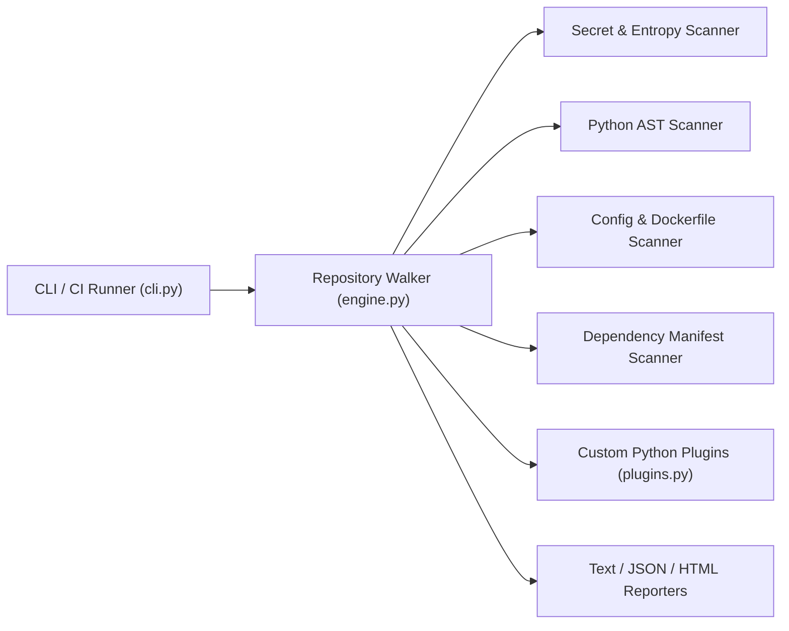

# DevGuard

Extensible repository security, secret detection, Python AST static analysis, configuration audit, and dependency hygiene scanner.

## Purpose & Problem Statement

Teams frequently juggle separate tools for secret scanning, Dockerfile hardening, Python AST static checks, and dependency pinning validation, making local pre-commit auditing and CI enforcement inconsistent. DevGuard consolidates verifiable static checks into a zero-dependency Python CLI and extensible plugin engine that outputs terminal summaries, structured JSON, and standalone HTML reports.

## Features

- **Secret & Credential Detection**: Matches known credential formats (AWS Access Keys, GitHub tokens, Slack tokens, Stripe live keys, PEM private keys) and analyzes high-entropy assignments using Shannon entropy while ignoring placeholders and `# devguard:ignore` lines.
- **Python AST Security Analysis**: Parses Python files via the `ast` module to flag `eval`/`exec`, `os.system`, `subprocess(..., shell=True)`, `pickle.load(s)`, unsafe `yaml.load`, unexempted MD5/SHA1 calls, and `verify=False` TLS bypasses.
- **Configuration & Container Audits**: Detects committed `.env`/`.pem`/`.key` files, Dockerfiles without a non-root `USER` or using `:latest` base tags, `DEBUG = True`, and wildcard CORS origins.
- **Dependency Manifest Hygiene**: Checks `requirements.txt`, `pyproject.toml`, `package.json`, and `go.mod` for unpinned dependencies, insecure `http://` sources, and local filesystem `replace` directives.
- **Plugin System & Reporting**: Loads custom `.py` rule modules (`run_plugin(root, cfg)`) from `--plugin` or `.devguard_plugins/`, and exports text, JSON, or HTML reports with configurable `--fail-on` CI exit codes.

## Tech Stack

- **Language**: Python 3.11+ (100% standard library runtime: `ast`, `tomllib`, `json`, `re`, `importlib`)
- **Tooling**: `pytest`, `ruff`, `mypy`

## System Requirements

- Python 3.11 or newer

## Installation

```bash
git clone https://github.com/fully-ai/devguard.git
cd devguard
python3 -m venv .venv
source .venv/bin/activate
pip install -e ".[dev]"
```

## Configuration

Copy `.devguard.toml.example` to `.devguard.toml` in your repository root:

```toml
exclude_dirs = [".git", ".venv", "node_modules", "dist"]
disabled_rules = ["DEP-001"]
entropy_threshold = 4.3
min_secret_length = 20
```

## Running & Usage Examples

```bash
# Scan current repository and fail CI on HIGH or CRITICAL findings
devguard scan . --format text --fail-on high

# Generate standalone HTML security dashboard
devguard scan /path/to/repo --format html --output report.html --fail-on none

# Generate JSON report with a custom plugin
devguard scan . --plugin ./my_rule.py --format json --output findings.json
```

## Rule Reference

| Rule ID | Category | Default Severity | Description |
| --- | --- | --- | --- |
| `SEC-001`..`SEC-005` | `secrets` | `HIGH`/`CRITICAL` | AWS, GitHub, Slack, Stripe, and PEM private key patterns |
| `SEC-006` | `secrets` | `HIGH` | High-entropy literal assigned to secret/token/password variable |
| `PY-001`..`PY-007` | `sast` | `MEDIUM`/`HIGH` | `eval`/`exec`, `os.system`, `shell=True`, `pickle`, `yaml.load`, weak hashes, `verify=False` |
| `CFG-001`..`CFG-005` | `config`/`container` | `MEDIUM`/`HIGH` | Committed `.env`/keys, `:latest` base image, root container user, `DEBUG=True`, wildcard CORS |
| `DEP-001`..`DEP-004` | `dependencies` | `LOW`–`HIGH` | Unpinned Python/NPM dependencies, `http://` sources, local `go.mod` `replace` |

## Architecture



## File Structure

```
devguard/
├── src/devguard/
│   ├── cli.py                 # CLI entrypoint & exit-code enforcement
│   ├── engine.py              # Directory traversal & scanner orchestration
│   ├── models.py              # Finding, Severity, GuardConfig (.devguard.toml)
│   ├── plugins.py             # Custom Python rule module loader
│   ├── reporters.py           # Text, JSON, and HTML report formatters
│   └── scanners/
│       ├── secrets.py         # Signature + Shannon entropy scanner
│       ├── python_ast.py      # Python AST SAST rules
│       ├── config_scan.py     # .env, Dockerfile, CORS, DEBUG checks
│       └── deps.py            # requirements.txt, pyproject.toml, package.json, go.mod
├── tests/test_devguard.py
├── docs/
│   ├── architecture.md
│   └── ci-integration.md
└── Dockerfile
```

## Testing

```bash
ruff check src tests
mypy src
pytest -v
devguard scan . --fail-on high
```

## Docker Deployment

```bash
docker build -t devguard .
docker run --rm -v "$PWD:/workspace:ro" devguard scan /workspace --fail-on high
```

## Security Notes

- Runs offline without sending source code or findings to external services.
- Only execute plugins from trusted paths (`--plugin` or `.devguard_plugins/`).

## Known Limitations

- Static AST security checks currently target Python (`.py`) files; secret, config, container, and dependency rules apply across all languages.
- Dependency checks verify manifest hygiene (pinning, transport scheme, local overrides) rather than querying remote CVE feeds such as OSV.dev.

## Contributing

See [CONTRIBUTING.md](CONTRIBUTING.md) and [CODE_OF_CONDUCT.md](CODE_OF_CONDUCT.md).

## License

Apache License 2.0 — see [LICENSE](LICENSE).
